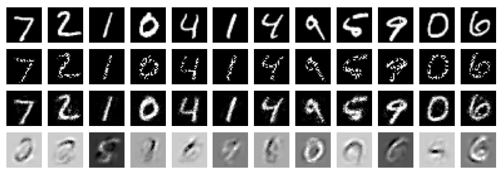

# Generative predictive coding via dyadic sparse coding — the inference backprop can't do

**Date:** 2026-06-19 · **Code:** `tikitorch/nn/predictive_coding.py`
(`SparseCodingPC`), `scripts/pc_sparse_coding.py`, tests in
`tests/test_predictive_coding.py`. · **Data:** MNIST.

## TL;DR

Everything else in this PC effort computes the **backprop gradient** by a hardware-
friendlier route (the cascade and error-relaxation *are* backprop; see
`SCALE_TESTS.md`). This is the one result that does something **a feed-forward
backprop net structurally cannot**: a multiplier-free, tropical **sparse-coding
generative PC** that, trained with **no backprop**, answers *arbitrary* inference
queries by settling — reconstruction and in-painting under **any** corruption mask.
On MNIST it recovers digits from 50% random pixel masking **~60% better than a mean-
fill baseline**, with the *same* model handling any mask pattern.

## Why the obvious routes failed first (and this one doesn't)

- A **discriminative** PC at its true (CG-converged) equilibrium just reproduces
  backprop — no inference capability, no continual-learning edge (`SCALE_TESTS.md`).
- A **PC autoencoder** trained to reconstruct *copies* the visible input: with no
  generative prior, a masked input has nothing forcing a completion, so it leaves the
  masked region near-empty (measured: infill *worse* than mean-fill).
- **Sparse coding** (Olshausen-Field / Rao-Ballard — the original generative PC)
  *is* the prior: model each image as a **sparse** combination of learned atoms. That
  prior is exactly what enables completion — and **sparsity is tropical-native**
  (top-k = winner-take-all = the max-plus primitive). It is the one PC formulation
  where the tropical/max structure is the *point*, not a constraint.

## The model (`SparseCodingPC`)

`x ≈ D·s`, with the code `s` **k-sparse** and the dictionary `D` **dyadic** (±2^k
columns, unit norm — multiplier-free). Nothing here is backprop:

- **Inference (settle):** descend `½‖mask⊙(x − D·s)‖²` over `s`, then keep the top-k
  atoms (WTA) each step. `mask` restricts the fit to *observed* pixels, so the same
  routine does reconstruction (full mask), in-painting (any mask), or denoising.
- **Learning (local):** after settling, a local dyadic dictionary update
  `ΔD ∝ q(err) ⊗ q(s)` (operand-quantized → shift-add), then re-normalize atoms.

## Results (MNIST, 196 atoms, 15-sparse, 40 epochs, no backprop)

Reconstruction MSE settles to **0.0192**. In-painting (error on the **missing**
pixels only):

| query | sparse-PC | mean-fill | improvement |
|---|---|---|---|
| bottom-half masked | 0.0614 | 0.0667 | 8% |
| **random 50% masked** | **0.0260** | 0.0650 | **60%** |

Bottom-half completion is *easy* (digit bottoms are predictable, so mean-fill is a
strong baseline); the honest demonstration is **random masking**, where structure-
recovery matters and sparse coding wins by a wide margin. Qualitatively (figure
below) the completions are **recognizable digits** recovered from scattered pixels,
and the most-used dictionary atoms are real **stroke/loop features**.



(Rows: original · 50%-random-masked input · PC in-painting · top-used dyadic atoms.)

## The point

A discriminative backprop net is a fixed `input → label` map; it cannot, at test
time, infer missing inputs or denoise without a *separately trained, task-specific*
decoder. The sparse-coding PC needs **one** trained model and answers **any** "infer
X given Y" query by settling — the genuine PC capability that backprop lacks — and it
does so **multiplier-free** (±2^k dictionary, top-k gate) with a **local** learning
rule. This is where "tropical PC" earns its keep.

## Honest scope

- **Single-layer / MNIST.** A shallow sparse coder on an easy dataset; not a deep or
  SOTA generative model. Hierarchical / harder data is future work.
- **MSE-on-missing** is a coarse metric; it understates the easy (bottom-half) case
  and is most meaningful on random masking. No likelihood / FID.
- The float-sim inference runs matmuls; closure is the weight-VALUE property (±2^k
  dictionary + top-k code), same as `DyadicLinear` elsewhere.
- The dictionary normalization is a host op (unit-norm columns); the *deployed*
  dictionary is ±2^k.

## Reproduce

```
PYTHONPATH=. python scripts/pc_sparse_coding.py            # trains + in-paints + saves the figure
PYTHONPATH=. python -m pytest tests/test_predictive_coding.py -q -k sparse
```
