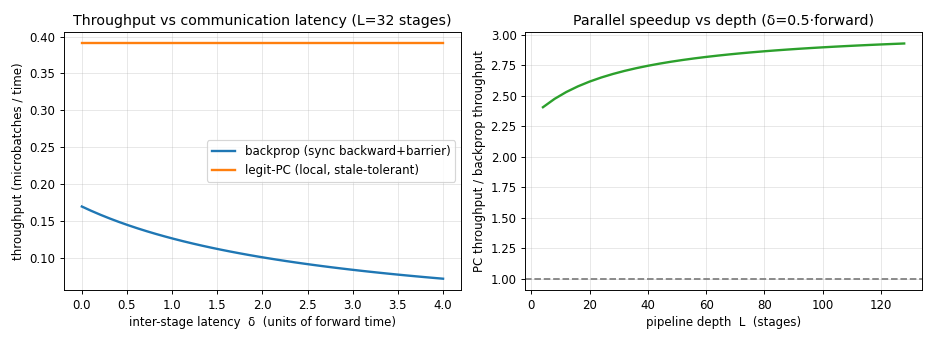

# The actual thesis: PC's value is parallelism axes backprop structurally lacks

**Date:** 2026-06-19. Evidence: the async error-relaxation results in `SCALE_TESTS.md`
(committed, multi-seed); framing per the locking analysis of Jaderberg et al. 2017
("Decoupled Neural Interfaces").

## The reframe

This whole effort established, honestly, that on accuracy our PC ≈ backprop (the
cascade / error-relaxation *are* backprop via Z-IL; `SCALE_TESTS.md`). So accuracy is
**not** the value proposition — backprop already gets it. The value of being a **legit
PC** (local energy, settling, no global backward) is that it **removes the
synchronization that makes backprop hard to parallelize**, opening axes you can split
work over "for free." That is the hardware thesis, and it is the right axis to compete
on.

## Backprop's three locks (and which PC breaks)

Backprop on an L-layer net imposes a strict global schedule:

1. **Forward lock** — layer l can't compute until l−1 is done. *(PC keeps this — there
   is a forward pass.)*
2. **Update lock** — *no* layer can update its weights until the **entire** forward
   **and** backward have completed. The backward is a second, full, sequential sweep.
3. **Backward lock** — layer l's gradient needs layer l+1's gradient first: the
   backward traverses all layers **in order**, end to end, with a global barrier, and
   the credit signal is **non-local** (it is routed across the whole network).

The critical path is **2L sequential stages + a global barrier**, and the weight
gradients are a global all-to-all dependency. That is exactly what you cannot afford
on neuromorphic / in-memory / wafer-scale / multi-chip-async hardware.

**PC breaks locks 2 and 3.** Its weight update is **local** — each layer's update uses
only its own prediction error and its own activity (`ΔW_l ∝ ε_l ⊗ x_l`). Once the
states are settled, **every layer updates simultaneously**; there is **no sequential
backward sweep** and **no global gradient to route**. Credit is carried by the local
energy-relaxation, which is *local in space* (neighbours only) and can be made *local
in time* (any order, with delay).

## The axes you can trivially parallelize over

| axis | backprop | legit PC (settling / error-relaxation) |
|---|---|---|
| **layer-parallel updates** | no — sequential backward sweep, all layers blocked until it finishes | **yes** — all layers update at once from local errors (no backward lock) |
| **no global gradient routing** | needs all-to-all gradient communication | **yes** — credit is local message-passing (neighbour-only) |
| **asynchronous / no global clock** | a global barrier per step | **yes** — relaxation converges under any update order |
| **partial participation** | every layer must run every step | **yes** — workers can drop a round and it still converges |
| **delay / staleness tolerance** | a stale gradient is simply wrong | **yes** — neighbours can read lagged values (the triangular system still converges) |
| **sparse-inference parallelism** | dense backprop | **yes** — top-k code inference (generative PC) is embarrassingly parallel over atoms |

## The evidence we already measured

The async error-relaxation (`SCALE_TESTS.md`, full MNIST, multi-seed) is a direct
measurement that the credit assignment **survives exactly the conditions parallel
hardware imposes**:

- **Sync == cascade == backprop, bit-exact** — the local/iterative form computes the
  *identical* gradient when run synchronously, so we give up nothing in the easy case.
- **Async = sync within ~0.1–0.6pp** under **50% participation + stale (lagged) reads +
  random update order**, at depths d4–d32. I.e. half the workers silent each round, no
  global clock, no global schedule, lagged communication — and it still trains to the
  same accuracy.

The naive *state*-settling that diverges at scale is the one we replaced; the
**error-relaxation** is the stable, async-robust form (triangular/nilpotent —
unconditionally convergent regardless of order or weight scale).

## Why this is the right competition (and where it leaves the field)

Every competing PC work (Qi, μPC, Salvatori; `BENCHMARK.md`) is **FP32 with real
multipliers**, and settling-PC is in fact *more* multiply-heavy and *more* sequential
per step than backprop (T inference iterations × the layer sweep). They compete with
backprop on **accuracy** — a race backprop wins or ties. We have two axes none of them
have, and they compound:

- **Multiplier-free** (±2^k shift-add, top-k WTA) — no DSP multiplies.
- **Synchronization-free** (local, async, delay/partial-tolerant) — no global backward,
  no global clock, no all-to-all gradient routing.

That combination is what maps onto neuromorphic / in-memory-compute / wafer-scale /
chiplet-async substrates, where **backprop's global synchronous backward is the
blocker, not the FLOP count**. The honest claim is therefore not "PC is more accurate"
— it is "PC reaches backprop-quality credit assignment **multiplier-free and without
global synchronization**, which is the regime that hardware actually constrains."

## Modeled throughput (the structural argument, made quantitative)

A pipeline-parallelism throughput model (`scripts/.../throughput_model.py`,
`throughput_model.png`) turns the locks into numbers. It is **not** measured
wall-clock — it is derived from the dependency structure, and the only PC-favoring
assumptions are the *actual* differences, each grounded:

- backprop has a **backward sweep** (cost τ_b/stage); PC has **none** (local updates);
- backprop needs a **sync barrier** (exact all-reduced gradients); PC has **none**;
- backprop **cannot use stale gradients**, so inter-stage latency δ sits **on the
  critical path** (2L hops + barrier); PC **tolerates staleness** (this is the part we
  *measured*: async 50%+stale+random within ~0.6pp), so δ is **hidden** (overlapped).

For a standard L-stage / B-microbatch pipeline (τ_f = 1, τ_b = 2, local-update 0.3):

| condition | PC throughput / backprop |
|---|---|
| L=32, **zero** latency (δ=0) | **2.3×** — purely from having no backward sweep |
| L=32, δ = 1·τ_f | **3.1×** |
| L=32, δ = 2·τ_f | **3.9×** — staleness-tolerance hides the latency backprop pays |
| L=128, δ = 0.5·τ_f | **2.9×** |

PC's throughput is **flat in latency** (left: it hides δ); backprop's **decays** (δ is
on its critical path). The speedup **grows with depth** (right) — backprop's backward
sweep and latency both scale with L. So the parallelism advantage is real even with
*no* communication cost (the missing backward sweep = ~2.3×) and **compounds** under
the latency/asynchrony that real distributed hardware imposes.

## Honest scope

- The throughput numbers are a **model** (standard pipeline-parallelism dependency
  structure), not measured wall-clock on real async hardware; the staleness-tolerance
  that lets PC hide latency is the one piece we *measured* (async error-relaxation).
  Real-hardware throughput on a multi-chip / neuromorphic substrate is the next claim
  to substantiate.
- The model's constants (τ_b = 2·τ_f, local-update = 0.3·τ_f, barrier = δ) are typical
  but illustrative; the *qualitative* result (flat-in-latency vs decaying;
  grows-with-depth) follows from the dependency structure regardless of the exact
  constants.
